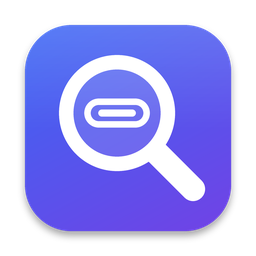

  

<h1 align="center">Port Detective</h1>

  See what your Mac’s ports are really doing. 
  A free menu bar app that shows the real speed of everything you plug in, and exactly what your charger delivers.

  <a href="../../releases/latest"><b>Download</b></a> &nbsp;·&nbsp;
  <a href="https://harshvardhanpal22.github.io/port-detective/">Website</a> &nbsp;·&nbsp;
  <a href="https://buymeacoffee.com/harshvardhanpal">Buy me a coffee</a>

---

## What it does

- **Real connection speeds.** Plug in a drive, hub, dock or webcam and a popup shows the speed it actually connected at: 480 Mb/s, 5 Gb/s, 10 Gb/s, 20 Gb/s or Thunderbolt.
- **Slow cables, caught.** If a drive is stuck at USB 2 speed, Port Detective warns you that the cable or hub is holding it back. Many USB-C charging cables are USB 2 only.
- **Charger details.** See a charger’s real wattage, the voltage and current your Mac agreed on, every power level it offers, and a warning if it’s too weak.
- **Live power readings.** See how much power your Mac is drawing and how much is going into the battery.
- **Device icons that make sense.** Phones, drives, webcams, keyboards, hubs, Ethernet adapters, security keys and more each get their own icon.
- **Settings.** Turn popups and sounds on or off, pick a sound, preview the popups, and open the app at login.

## Install

1. Download `PortDetective.zip` from the [latest release](../../releases/latest) and double-click it to unzip.
2. Drag **Port Detective** into your Applications folder.
3. Open it. macOS will say it can’t verify the app, because free apps like this one aren’t notarized by Apple. Click **Done**, open **System Settings > Privacy & Security**, scroll down and click **Open Anyway**.

The connector icon then appears in your menu bar. There’s no Dock icon.

Requires macOS 14 Sonoma or later.

## Build it yourself

You need Apple’s free Command Line Tools (`xcode-select --install`) or Xcode.

- **Easiest:** download this repository (**Code > Download ZIP**), unzip it and double-click `Install Port Detective.command`. It builds the app, installs it in Applications and opens it.
- **From Terminal:** `./build.sh run` builds and launches the app from `./build`, and `./build.sh install` copies it to Applications.
- **In Xcode:** `open Package.swift`.

To remove the app, double-click `Uninstall Port Detective.command`.

## Privacy

Port Detective only reads what macOS already knows about your ports and charger, through the I/O Registry. It has no account, never connects to the internet, collects no analytics, and needs no special permissions.

## Good to know

- **It measures links, not cables on their own.** The speed shown is the slowest of the device, the cable, any hubs and the Mac’s port. To test a cable, plug a fast drive in through it.
- **The USB 2 warning only appears for drives.** Keyboards, mice and most webcams are meant to run at USB 2 speed.
- **Thunderbolt and USB4 devices are listed without a speed,** because macOS doesn’t reliably report their link rate.
- **Charger details are most complete on MacBooks with Apple silicon.** Desktop Macs don’t report charger details.

## How it works

| File | What it does |
|---|---|
| `DeviceMonitor.swift` | Watches IOKit for USB and Thunderbolt devices being plugged in and removed |
| `DeviceInspector.swift` | Reads each device’s name, vendor, negotiated speed and the hub it’s connected through |
| `DeviceClassifier.swift` | Works out what a device is, from its name first and its USB interface classes second |
| `PowerMonitor.swift` | Reads charger and battery details and watches for a charger being connected |
| `StatusItemController.swift` | The menu bar icon and the rounded panel beneath it |
| `HUDController.swift` | The popup in the corner of the screen |
| `ChargeIllustration.swift` | The animated plug and battery |

The website lives in `docs/` and is served by GitHub Pages.

## Releasing a new version

1. Update `CFBundleShortVersionString` and `CFBundleVersion` in `Resources/Info.plist`.
2. On GitHub, go to **Releases > Draft a new release**, create a tag such as `v1.1`, and click **Publish release**.
3. GitHub Actions builds the app and attaches `PortDetective.zip` to the release within a few minutes.

## Support

Port Detective is free, with no ads and no tracking, and it always will be. If it found you a slow cable or a weak charger, you can support its development:

It’s completely optional, and every feature stays free for everyone. Starring the project, reporting bugs and telling friends help just as much.

## Contributing

Bug reports and pull requests are welcome. If a device shows the wrong icon, please open an issue with its name as shown in the app.

## License

Port Detective is free and open source under the [MIT License](LICENSE).

Made by Harshvardhan Pal. Mac and macOS are trademarks of Apple Inc. Port Detective is not affiliated with or endorsed by Apple.
